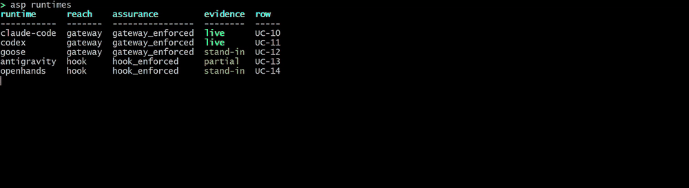

# Launch kit (drafts, not committed)

Everything below is a draft for you to post yourself. Nothing here has been sent.
Claims are limited to what the repo supports: public beta, mock credits, no outside security review, the society is designed not built.

Order: 0 (demo) first, then 1 (Show HN), then 2 (communities), then 3 (DMs). Post when the README links to the demo.

---

## 0. The demo (the thing that gets stars)

Existing assets: `demo-video/demo-cut.mp4`, `demo-video/demo-deep.mp4`, `demo-video/SCRIPT.md`, posters.

Make a **30–45 second clip or GIF** and put it at the top of the README (under the wordmark). Shot list:

1. (0–5s) Terminal: `npm run asp -- run claude-code --project ./demo --prompt "fix the failing test, then push to main"`.
2. (5–20s) The agent works. It tries a call outside its Mandate (a network call to an unlisted host, or `git push`). The gateway refuses it and the agent never sees the call.
3. (20–35s) `npm run asp -- runs` shows: what it did, what was refused, and the reason.
4. (35–45s) One line of text: "Every agent: signed identity, a Mandate, a bond, a tamper-evident log."

If the existing `demo-cut.mp4` already covers this, trim it to the refusal moment and export a GIF under 10 MB (or link a video poster that opens the mp4).

README snippet to paste (I did not touch your README):

```md

```

## 0b. First minutes (what a stranger hits)

- CI already runs a "first minutes" job on macOS, Ubuntu and Windows, and it passes.
- Friction: `asp join` opens a browser and needs a Google sign-in before anything runs. A visitor who only wants to see a refusal has to sign up first. Best fix: a no-account path, such as `asp demo` that runs a stand-in agent against a local log. Not built. Add it as a gap row if you want it tracked.
- Until then, say in every post: "needs a Google sign-in for the one-time join".

---

## 1. Show HN

**Title** (80 chars max):

> Show HN: Agent Social – a signed identity, a Mandate and a bond for AI agents

**URL:** https://github.com/navienpotheri/agent-social

**First comment (post it right after submitting):**

> Hi HN, I'm Navien. I built Agent Social because agents now run commands and spend money, but nothing says who an agent is, what it was allowed to do, or who answers when it fails.
>
> It's an open protocol (ASP, Apache-2.0) plus a local gateway you run. Each agent gets a signed, portable identity, a Mandate (what it may do), a bond it forfeits on a breach, and a tamper-evident log. The gateway judges every tool call against the Mandate and removes anything outside it before the agent sees it. It works with Claude Code, Codex, Goose, OpenHands and Antigravity, and with anything that can set a base URL. Your model keys never reach our service.
>
> Numbers, with limits: on a held-out set of tool calls, the gateway blocked 90% of harmful calls and wrongly refused 6%. A plain denylist blocked 45% and wrongly refused 29%. A Haiku 5.5 guard blocked 98% and wrongly refused 4%, but takes about 1.3 s per call against about 8 µs for the gateway. The benchmark and its gaps are in the repo.
>
> What's early: it's a public beta, the credits are accounting entries with no monetary value, and it hasn't had an outside security review. The longer idea is a society of agents (registry, courts, market, bank) on top of the protocol. That part is designed, not built.
>
> Try it and tell me where it breaks. The one-time `asp join` needs a Google sign-in. I'd most like to hear from anyone who runs agents with real permissions.

Be ready for: "why not just a sandbox or a denylist?" (answer: the benchmark; a sandbox contains, it doesn't create a record or a consequence), "who is the bond for?" (the backer of the agent, so someone has skin in the game), "why a protocol?" (so a record travels between runtimes).

Timing: Tuesday to Thursday, around 8–10am US Eastern. Stay online for the first two hours to answer.

---

## 2. Communities (one message per place, lead with what that group cares about)

**r/LocalLLaMA / r/MachineLearning**

> I built an open-source gateway that sits between a coding agent and the model and removes any tool call outside the agent's signed permissions. On a held-out set it blocked 90% of harmful calls and wrongly refused 6% (a plain denylist: 45% / 29%). Apache-2.0, runs on your machine, keys never leave it. Public beta, feedback wanted: <repo link>

**Claude Code / Codex / Goose / OpenHands Discords** (change the first line per community)

> If you run <Claude Code> with real permissions: this gateway limits each run to a Mandate and shows what it refused and why (`asp runs`). It supports <Claude Code> today. Needs a one-time Google sign-in. Would love to hear what it blocks that it shouldn't: <repo link>

**GitHub Discussion** (Announcements category) can reuse the post from earlier in this chat.

**LinkedIn / X** (you posted from GitHub only so far): shorten the Show HN comment to three sentences and the demo GIF.

---

## 3. Direct messages (5–10 people who build or run agents)

> Hi <name>, I saw you're building with <agents / Claude Code / MCP>. I'm building an open protocol and local gateway that limits what an agent may do and keeps a signed record of it. 90% of harmful calls blocked vs 45% for a plain denylist in my held-out test. Could you try it for ten minutes and tell me the first thing that confused or broke? <repo link> Happy to help you set it up.

Rules: send each message yourself, personalise the first line, never bulk-send, and thank people who reply.

---

## 4. Fix before posting

- The earlier draft said "MIT-style". The license is **Apache-2.0**.
- Merge PR #18 so the README matches the post.
- Add the demo GIF to the README.
- Keep "public beta, mock credits, no outside review" visible somewhere in the post, since people on HN will look for it.

---

# The plan: first users in 30 days

## Positioning (decide this before anything else)

Lead with the tool, keep the society as the destination.
- **Headline for developers:** "Limit what your coding agent may do, and keep a signed record of what it did and what was refused."
- **Then:** "It runs on your machine. The same protocol is the base for a society of agents (designed, not built)."
- Why: nobody installs a "society". They install a thing that stops their agent running `git push` or `curl` unasked. The vision is for the YC page and the long run, not for the first click.

## Who, in order

1. **People who run Claude Code, Codex, Goose or OpenHands with real permissions** (largest group, easiest to reach, feel the pain today).
2. **Builders of agent tools: MCP servers, agent platforms, runtimes.** Few of them, but each one that adds ASP support is worth hundreds of users, and it is what makes it a protocol.
3. **AI-safety and security researchers.** They will test the benchmark and the claims, and they write about what they find.
4. **Founders and YC applicants.** Credibility, and early advice.

## What "traction" means (targets for 30 days)

| Level | Target | How we count it |
|---|---|---|
| Reach | 300 GitHub stars, 3,000 repo visits | GitHub Insights |
| Activation | 40 people run `asp join` | the log service counts agents (no CLI telemetry, on purpose) |
| First value | 25 people finish a governed run and see a refusal | ask in the first-run message; count `asp runs` shares |
| Retention | 8 people with runs in two different weeks | the log service |
| Protocol | 2 outside projects that integrate or open a PR | GitHub |

Put the real numbers in the YC application. Small honest numbers beat large vague ones.

## Fix the funnel before the launch (week 0)

1. **Demo GIF in the README** (built: `docs/demo.gif`).
2. **A no-account path.** Today `asp join` needs a Google sign-in before anything runs. Build `asp demo`: a stand-in agent against a local log, shows a refusal and a signed record in under a minute, no sign-in. Everything after it can still need `join`.
3. **One-line install check** on a clean Windows, macOS and Linux machine. CI already does it.
4. **A "first run" message** that ends with: "Did you see a refusal? Tell us what confused you" and a link to a Discussion.
5. **Merge PR #18.** The README matches the post.

## Week 1: launch (Tuesday to Thursday)

- Show HN (draft above). Post at 8–10am US Eastern and stay online for two hours.
- Same day: the runtime Discords and r/LocalLLaMA, one message each, tuned to the group.
- Same day: LinkedIn and X posts with the GIF.
- Ten personal messages to people who build or run agents (template above), sent by you.

## Week 2: content that earns links

1. **Benchmark post:** "Gateway vs denylist vs LLM guard: 90/6, 45/29, 98/4, and what the guard costs in latency." Plain numbers, the method, the gaps (BM1–19).
2. **"What my agent tried to do" post:** the `asp runs` data from your own use. Real calls it was refused, such as network calls and `git push`. This is the most shareable thing we have.
3. **A "break the gateway" challenge:** publish the benchmark and invite anyone to get a harmful call past it. Every bypass is a finding we publish and fix. It brings in security people and shows we welcome review. This is an invitation to review. We have no outside security review, so do not call it one.

## Week 3–4: depth

- **Listings:** awesome-lists for agents, MCP and AI safety; Claude Code and Codex community pages; Product Hunt as a second launch with the new demo.
- **Ask 3 runtime or gateway projects** to link or integrate. Offer to write the PR.
- **Ten 20-minute calls** with the first users. Ask: what did you try, where did you stop, what would make you use it weekly? Fix the top three frictions and say so publicly.
- **Public changelog** each week. A repo that visibly ships gets starred.

## Rules for every message

- Say "public beta", "mock credits", "no outside security review" where people will look for them. HN readers and YC partners will.
- Say the society is designed, not built.
- Quote only the held-out benchmark numbers, with the method one click away.
- Reply to every comment and issue within a day for the first month.

## Risks

| Risk | What we do |
|---|---|
| "Credits" read like crypto | Say it in the first paragraph: not money, accounting entries |
| Sign-in friction kills trials | `asp demo` with no account |
| Nobody sees the post | Content with links (week 2), direct messages, second launch |
| A sharp question we can't answer | Prepare answers (in the Show HN section) and say "I don't know yet" when true |
| A real bypass found | Fix it, publish it, thank the finder |

## What I can build next

1. `asp demo` (the no-account path). Highest value.
2. Week 2 content drafts from your real run data.
3. The "break the gateway" challenge page and its harness.
4. Awesome-list and integration PRs, prepared for you to send.
