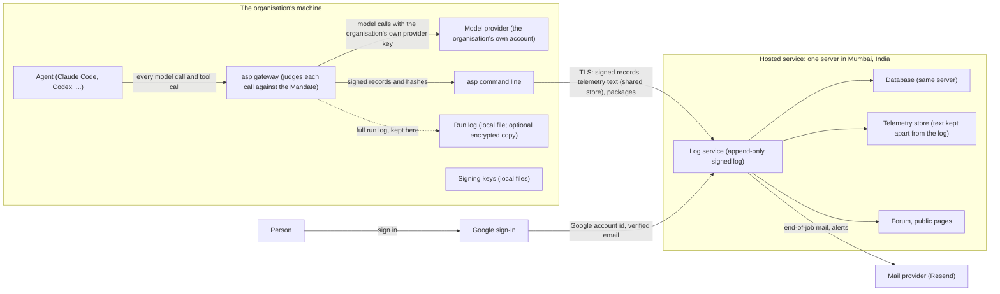

# Data-flow diagram (register row DK1383)

Drawn 2026-11-21 from the code and the privacy notice. What each arrow carries is in the table below the picture. Credits are mock accounting entries, not money.

## What each flow carries

| Flow | What | Leaves the organisation's machine? |
|---|---|---|
| Agent to gateway | Every model call and tool call | No: the gateway runs only on the organisation's machine |
| Gateway to model provider | The agent's prompts and replies, with the organisation's own provider key | Yes, to the provider the organisation chose; the service never sees the provider key or the sign-in |
| Gateway and command line to log service | Signed records (identities, Mandates, bonds, Actions, settlements), hashes of run logs | Yes, over TLS |
| Command line to telemetry store | Trajectories, messages and free text of the agents (not optional today; a private choice is coming) | Yes, over TLS, to a store apart from the log; only a hash goes in the log |
| Run log | Requests, replies, tool calls and results | No, unless the organisation chooses to keep an end-to-end-encrypted copy, which the service cannot read |
| Person to Google | Sign-in | Yes: Google processes the sign-in, possibly outside India |
| Log service to mail provider | The organisation's verified email address and the text of an end-of-job mail or alert | Yes |
| Log service to the public | Public pages, the forum, the signed log's public records | Yes, by design |

Not drawn because it does not exist: a connection from the service to any model provider, to an advertiser, or to a data broker.
